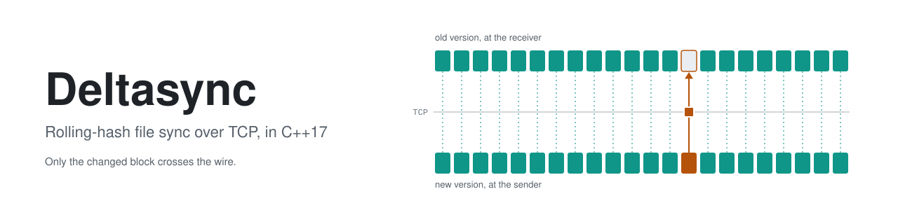
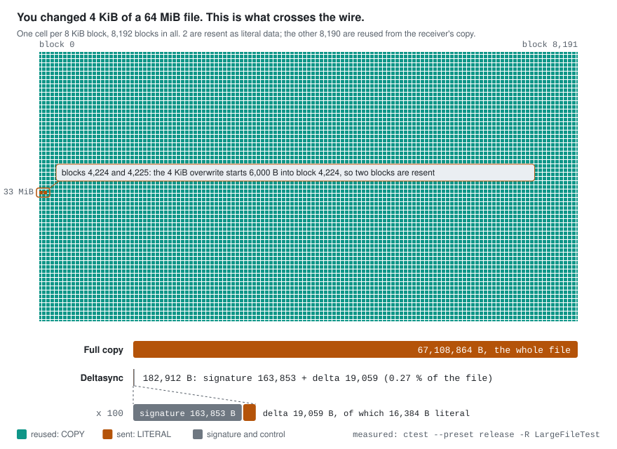
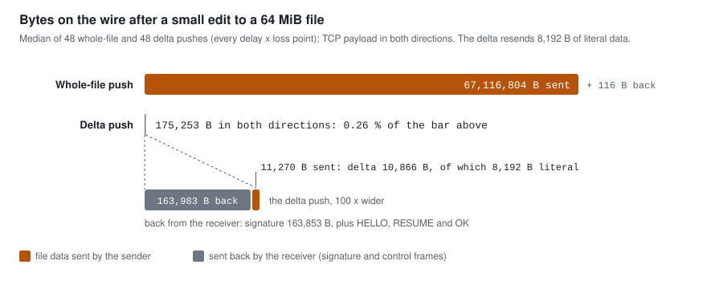
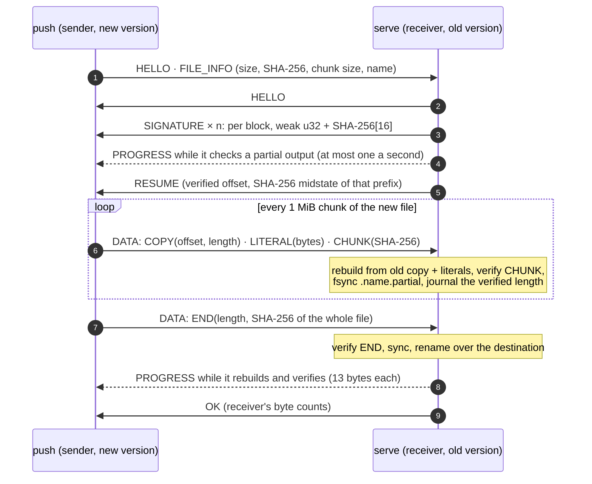
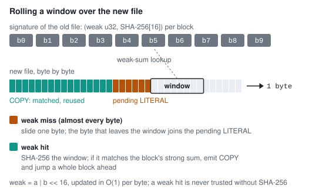
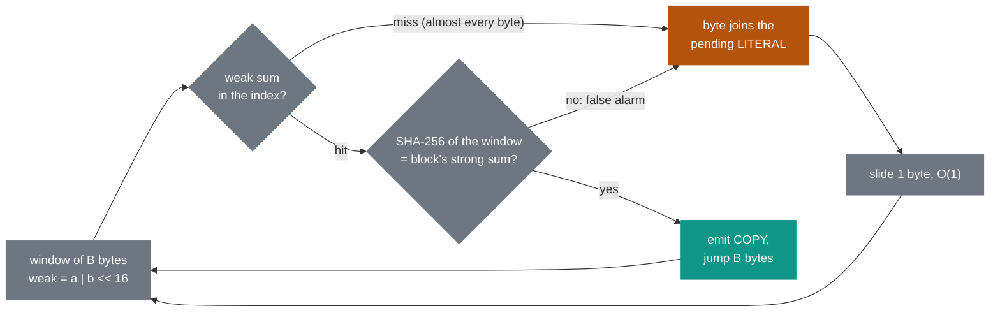
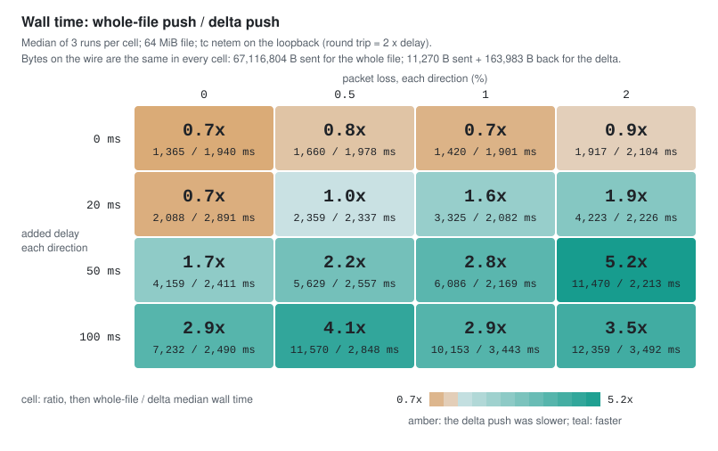
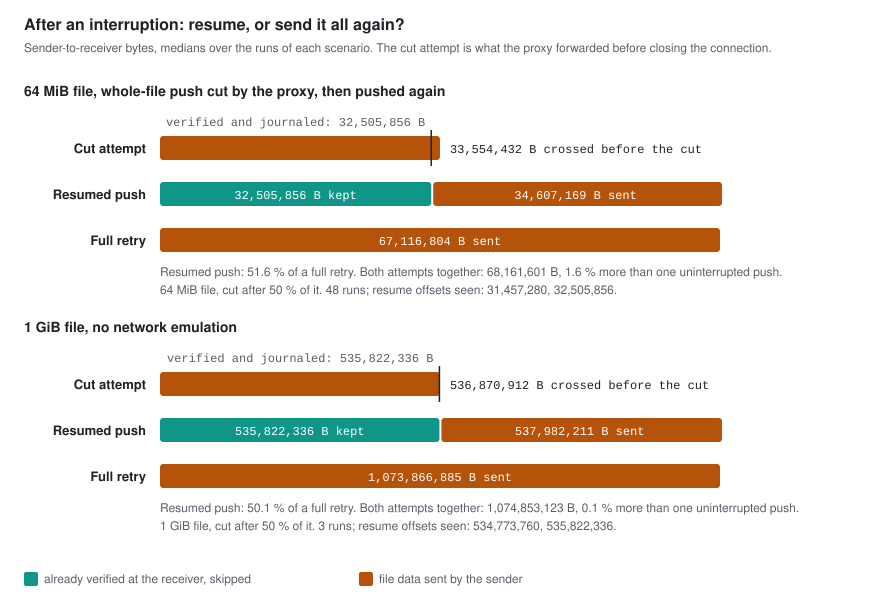

<picture>
  <source media="(prefers-color-scheme: dark)" srcset="docs/assets/banner-dark.svg">
  <source media="(prefers-color-scheme: light)" srcset="docs/assets/banner-light.svg">
  
</picture>

Deltasync brings a receiver's old copy of a file up to date over TCP by sending only the blocks it lacks.

    

[What crosses the wire](#what-crosses-the-wire) · [How it works](#how-it-works) · [Under latency and loss](#under-latency-and-loss) · [Interrupted, then resumed](#interrupted-then-resumed) · [Correctness](#correctness) · [Getting started](docs/GETTING_STARTED.md) · [Design](docs/DESIGN.md) · [Benchmarks](docs/BENCHMARKS.md)

Every figure uses one legend: **teal** is data the receiver already had (`COPY`), **amber** is data that crosses the wire (`LITERAL`), **slate** is the signature and control frames.

## What crosses the wire

<picture>
  <source media="(prefers-color-scheme: dark)" srcset="docs/assets/hero-dark.svg">
  <source media="(prefers-color-scheme: light)" srcset="docs/assets/hero-light.svg">
  
</picture>

The same kind of edit to a 1 GiB file, pushed over TCP to a receiver that holds the old version:[^1]

| 1 GiB file, 4 KiB edit | Whole-file push | Delta push |
| --- | ---: | ---: |
| sender to receiver | 1,073,866,885 B | 80,777 B |
| receiver to sender (its signature and control frames) | 350 B | 656,352 B |
| both directions, share of the file | 1,073,867,235 B (100 %) | 737,129 B (0.069 %) |

The 64 MiB version of the same push, measured at every netem grid point

 
<picture>
  <source media="(prefers-color-scheme: dark)" srcset="docs/assets/netem-bytes-dark.svg">
  <source media="(prefers-color-scheme: light)" srcset="docs/assets/netem-bytes-light.svg">
  
</picture>

## How it works

<picture>
  <source media="(prefers-color-scheme: dark)" srcset="docs/assets/rolling-window-dark.svg">
  <source media="(prefers-color-scheme: light)" srcset="docs/assets/rolling-window-light.svg">
  
</picture>

> [!IMPORTANT]
> Nothing appears at the destination before the whole-file SHA-256 in `END` verifies: output goes to a hidden `.name.partial`, every chunk is checked against its `CHUNK` digest and fsynced, and only then is the file renamed into place.

## Under latency and loss

<picture>
  <source media="(prefers-color-scheme: dark)" srcset="docs/assets/netem-time-dark.svg">
  <source media="(prefers-color-scheme: light)" srcset="docs/assets/netem-time-light.svg">
  
</picture>

Medians of 3 runs per point, 64 MiB file, 4 KiB edit, `tc netem` on the container's loopback:[^grid]

| Added RTT, loss per direction | Whole-file push | Delta push |
| --- | ---: | ---: |
| 0 ms, 0 % | 1,365 ms | 1,940 ms (0.7x) |
| 40 ms, 2 % | 4,223 ms | 2,226 ms (1.9x) |
| 100 ms, 2 % | 11,470 ms | 2,213 ms (5.2x) |
| 200 ms, 0 % | 7,232 ms | 2,490 ms (2.9x) |
| 200 ms, 0.5 % | 11,570 ms | 2,848 ms (4.1x) |

Loopback netem shapes both directions, so RTT = 2 x delay; byte counts are TCP payload, not headers or retransmissions; the host was not idle (see [the caveats](docs/BENCHMARKS.md#caveats)).

## Interrupted, then resumed

<picture>
  <source media="(prefers-color-scheme: dark)" srcset="docs/assets/netem-resume-dark.svg">
  <source media="(prefers-color-scheme: light)" srcset="docs/assets/netem-resume-light.svg">
  
</picture>

The push resumes from the last verified 1 MiB chunk (a chunk is the verified blocks and literal data covered by one `CHUNK` digest), not from a single block:[^grid]

| After a cut at 32 MiB of a 64 MiB push | Sender bytes | Share of a full retry |
| --- | ---: | ---: |
| resumed push, from the 31 MiB the receiver had verified (46 of 48 runs; 30 MiB in 2) | 34,607,169 B | 51.6 % |
| full retry from zero | 67,116,804 B | 100 % |

## What the resume says, and what backs it

<table>
  <tr>
    <td width="33%" valign="top">
      <b>Rolling checksum, then a strong hash before any block is reused</b> 
      Weak sum a | b &lt;&lt; 16 rolled in O(1) per byte; every weak hit is confirmed by SHA-256 of the window. On the benchmark's 64 MiB file, whose single 4 KiB edit is block-aligned (unlike the straddling edit in the figure above): 8,191 weak hits, 0 false matches.  
      <a href="include/deltasync/rolling_checksum.h"><code>rolling_checksum.h</code></a> · <a href="src/delta_encoder.cpp"><code>delta_encoder.cpp</code></a> · <code>StrongHashRejectsAWeakOnlyMatch</code> in <a href="tests/delta_encoder_test.cpp"><code>delta_encoder_test.cpp</code></a> · <code>delta --stats</code> on <code>make_test_files.py --size 64M --edit-size 4K</code>, recorded in <a href="docs/DESIGN.md#errors-and-exit-codes">DESIGN.md</a>
    </td>
    <td width="33%" valign="top">
      <b>Only the changed regions cross the TCP connection</b> 
      1 GiB file, 4 KiB edit: 80,777 B sent instead of 1,073,866,885 B, plus the receiver's 655,375 B signature coming back. 64 MiB: 11,270 B sent, 163,983 B back.  
      <a href="bench/results/no-netem-1g.csv"><code>no-netem-1g.csv</code></a> · <code>LargeFileWithASmallEditSendsKilobytes</code> in <a href="tests/sync_test.cpp"><code>sync_test.cpp</code></a>
    </td>
    <td width="33%" valign="top">
      <b>Measured under tc netem; resumes from the last verified chunk</b> 
      16 delay x loss points, 3 runs each: 1.7x to 5.2x faster than a full copy at 100 ms RTT. After a cut at half the file, the resumed push sent 51.6 % of a full retry (50.1 % at 1 GiB).  
      <a href="bench/results/netem.csv"><code>netem.csv</code></a> · <a href="scripts/netem_bench.sh"><code>netem_bench.sh</code></a> · 13 cut points in <a href="tests/resume_sync_test.cpp"><code>resume_sync_test.cpp</code></a>
    </td>
  </tr>
</table>

## Correctness

| Configuration | Tests | Result[^tests] |
| --- | ---: | --- |
| macOS, Apple clang, `debug` preset | 318 | 100 % passed |
| macOS, `release` preset | 318 | 100 % passed |
| macOS, `asan` preset (AddressSanitizer + UndefinedBehaviorSanitizer) | 314 | 100 % passed, no reports |
| macOS, `tsan` preset (ThreadSanitizer) | 314 | 100 % passed, no reports |
| macOS, `debug-stress` preset: 1 GiB and 4 GiB + 3 B SHA-256, 3,000 random edit sequences, scattered edits to 256 MiB | 4 | 100 % passed |
| Linux (Ubuntu 24.04 container), g++ 13.3.0 Debug | 318 + 4 stress | 100 % passed |
| Linux, clang++ 18.1.3 Debug | 318 + 4 stress | 100 % passed |
| Linux, g++ 13.3.0 Release | 318 | 100 % passed |

The 4 allocation-counting tests replace the global `operator new`, as the sanitizers do, so the sanitizer presets build 314.

## Layout

| Path | What is there |
| --- | --- |
| [`include/deltasync/`](include/deltasync), [`src/`](src) | the library: rolling checksum, SHA-256, signature, delta encoder and decoder, patcher with atomic replace, resume journal, framed TCP protocol, sender and receiver |
| [`tools/`](tools) | the `deltasync` CLI (`signature`, `delta`, `patch`, `serve`, `push`) and `deltasync_proxy`, a TCP forwarder that cuts connections after N bytes |
| [`tests/`](tests) | GoogleTest suites, the `stress` label, and the allocation-counting binary |
| [`scripts/`](scripts) | netem benchmark runner, test-file generator, CSV to Markdown, figure generators, and their self-test |
| [`bench/results/`](bench/results) | the CSVs behind every number above |
| [`docs/`](docs) | [Getting started](docs/GETTING_STARTED.md) (every command), [Design](docs/DESIGN.md) (formats, protocol, resume, known issues), [Benchmarks](docs/BENCHMARKS.md) (method, environment, full tables) |
| [`docker/`](docker) | the `deltasync-dev` image (Ubuntu 24.04, GCC, Clang, iproute2) used for the Linux runs and netem |

## Limits

| Limit | Consequence |
| --- | --- |
| no authentication or encryption | trusted networks only |
| one file per push, named by a single path component | a directory tree is one push per file |
| resume granularity is the chunk (default 1 MiB), and every attempt resends the signature | a cut costs up to one chunk of resent data plus one more signature |
| hashing and the rolling search cost more than a loopback memory copy | without added latency the delta push is slower than a plain copy (0.7x to 0.9x at 0 ms) |

## References

| Reference | Used for |
| --- | --- |
| A. Tridgell and P. Mackerras, *The rsync algorithm*, Technical Report TR-CS-96-05, The Australian National University, 1996 | the rolling checksum and the signature, delta, patch scheme |
| NIST, *Secure Hash Standard (SHS)*, FIPS PUB 180-4, 2015 | the in-tree SHA-256 |
| Linux manual page `tc-netem(8)`, Network Emulator | the delay and loss grid |

[^1]: `bench/results/no-netem-1g.csv`: `JOBS=4 scripts/run_netem_bench_docker.sh --no-netem --size 1G --edit-size 4K --repeats 3 --delays 0 --losses 0`, medians of 3 runs, release build with g++ 13.3.0 inside the `deltasync-dev` container on an Apple M5 host; environment and caveats in [docs/BENCHMARKS.md](docs/BENCHMARKS.md#results). The figure above it is `ctest --preset release -R LargeFileTest -V` (in-memory encoder, seeded data, no network).
[^grid]: `bench/results/netem.csv`: `JOBS=4 scripts/run_netem_bench_docker.sh --size 64M --edit-size 4K --repeats 3`, 192 rows, same container and host; the interrupted push goes through `deltasync_proxy --drop-after-bytes 33554432 --drop-direction up`.
[^tests]: macOS: `cmake --preset <name> && cmake --build --preset <name> -j 4 && ctest --preset <name> -j 4`; Linux: the same tree configured with `-DCMAKE_CXX_COMPILER=g++` or `clang++` inside `deltasync-dev`, `ctest -LE stress` then `-L stress`. The commands are in [docs/GETTING_STARTED.md](docs/GETTING_STARTED.md).
